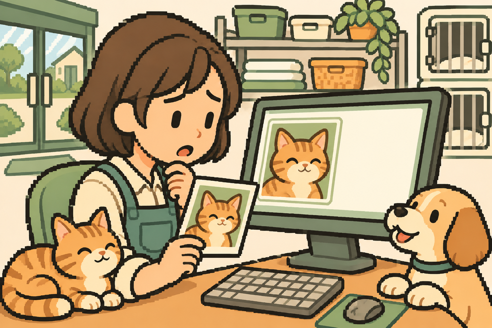
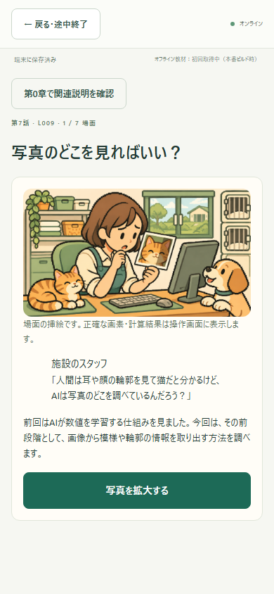
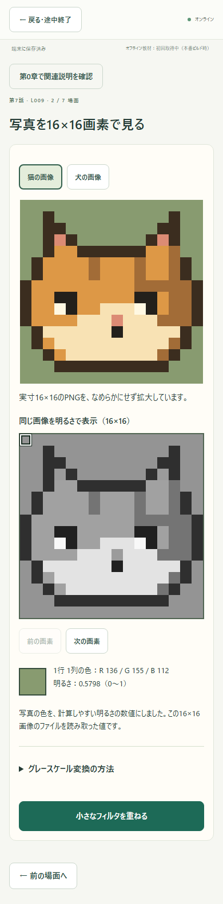
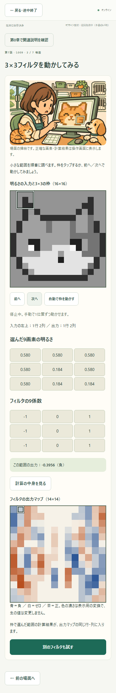
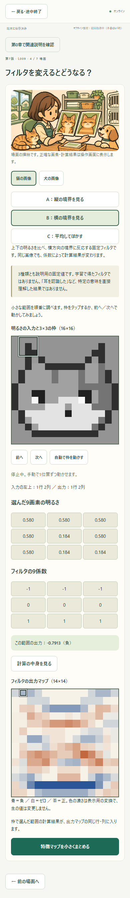
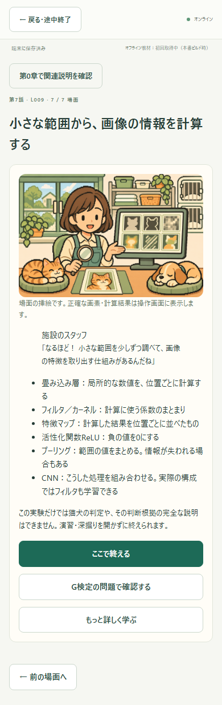
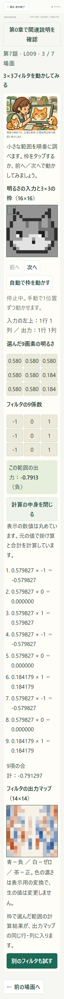

# v0.2.2 新規画像と組み込み確認

第5・6話の `public/illustrations/l008/mistaken-cat.png` を実際に開いて参照し、茶色のボブ、クリーム色の服、青緑のエプロン、猫と犬、クリーム色とセージ色の室内を引き継いだ。既存画像は上書きしていない。

| ローカルファイル                                   | 寸法      | 使用場面・意味                                           |
| -------------------------------------------------- | --------- | -------------------------------------------------------- |
| public/illustrations/l009/shadowed-photo.png       | 1672×941  | Scene 01。片側が少し暗い猫の写真を調べるスタッフ         |
| public/illustrations/l009/cat-16.png               | **16×16** | Scene 02以降の実計算入力。立った耳、輪郭、目、鼻、陰影   |
| public/illustrations/l009/dog-16.png               | **16×16** | 任意の入力切替。垂れた耳、長めの鼻、舌。猫とは異なる画素 |
| public/illustrations/l009/filter-investigation.png | 1536×1024 | Scene 03。写真と小さい枠を調べる場面                     |
| public/illustrations/l009/pattern-comparison.png   | 1672×941  | Scene 04。同じ猫の輪郭・模様を見比べるスタッフ           |
| public/illustrations/l009/image-lab-ending.png     | 1536×1024 | Scene 07。仕組みを理解したスタッフ                       |

物語用4点は画像制作機能で新規制作した。指示文は [image-prompts-v0.2.2.json](image-prompts-v0.2.2.json)。Canvas入力の2点は [create-l009-sprites.mjs](../scripts/create-l009-sprites.mjs) でオリジナルの画素絵をPNGとして制作した。作画用配列をアプリの計算へ読み込まず、実行時は保存されたPNGをImage→Canvas→getImageDataで取得する。全点ローカルPNGで、外部画像サイトや生成APIへの実行時接続はない。

SHA-256、バイト数、画素由来の全数値は [calculation-v0.2.2.json](calculation-v0.2.2.json) に記録した。日本語ラベル、係数、現在位置、計算結果はHTML／Canvas側に表示し、挿絵へ焼き込んでいない。各挿絵に代替テキストを設定した。

## 本文と一緒に表示した画面

## 320px・文字拡大

ブラウザ上では元PNGをニアレストネイバーで拡大する。上記画面で耳、目、鼻を視認し、挿絵・ボタン・数値が画面幅に収まることを確認した。WebKit版も同じディレクトリへ保存した。iPhone実機は未確認。
