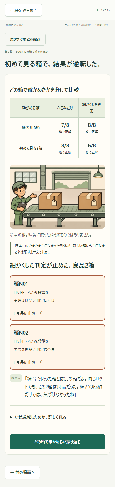

# v0.1.8 第3話 L005 実装報告

作業先：`C:/_wk/github/study-content/01_なぜから学ぶ G検定`。

第3話「練習では満点。新しい箱では、なぜ間違えた？」を、導入から成績の逆転、振り返り、完了まで実装した。第2話の「何を数えるか」に続き、「どの箱で確かめるか」を操作で確認する。既存の第0章、第1〜2話の本文・教材データ・元のPNGは維持した。

## 1本の操作手順

ホーム→「コース」→L005「第3話を始める」→検査員の依頼と練習箱を見る→「へこみだけを見る判定を試す」→練習7/8、箱P02の見逃し→「ロット番号も見て判定を細かくする」→練習8/8→予想は選んでも選ばなくてもよい→「新しく届いた8箱で試す」→同じ新着箱で8/8対6/8、箱N01・N02の止めすぎ→「どの箱で確かめるか振り返る」→過学習・汎化と練習用／評価用を分ける理由を読む→「ここで終える」。

第2話の結末「第3話を開く」からも開始できる。第2話の「ここで終える」「試験問題で確認する」はそのまま残り、自動的には移動しない。L005は予想・折りたたみ解説を開かずに完了できる。

## 計算結果

| 確かめた箱    | へこみだけを見る判定 | 細かくした判定 |
| ------------- | -------------------- | -------------- |
| 練習用8箱     | 7/8                  | 8/8            |
| 初めて見る8箱 | 8/8                  | 6/8            |

練習用8箱だけでしきい値0〜4を比較し、正解数が最大の2を採用する。基本ルールが外したP02から「ロットBかつへこみ段階0なら不良」という例外を作る。新着用データをしきい値・例外の決定に使わない。

同じ特徴を持つN01とN02は別IDの2箱として実際に判定・集計する。結果の数字や誤判定箱を直書きしていない。表示は「実際は良品／判定は不良」と明記し、色だけに頼らない。詳しいデータと計算方法は[教材仕様](CONTENT_L005.md)に記載した。

「過学習」「汎化」は逆転を見たあとの振り返りで紹介する。細かい判定が常に悪いとも、新着8箱の満点で性能が保証されるとも説明しない。

## 画像の保存先・使用場面

v0.1.7の実PNG `public/illustrations/l003/sorting-background.png` を参照して、組み込みimage_genで2点を新規制作した。同じ緑の帽子・作業着・髪と顔つき、くすんだ緑のコンベア、クリーム色の工場、箱とテープ、ドットの輪郭と陰影に合わせた。

| 保存先                                                                                                    | 場面                                                     | サイズ        |
| --------------------------------------------------------------------------------------------------------- | -------------------------------------------------------- | ------------- |
| [public/illustrations/l005/practice-inspection.png](../public/illustrations/l005/practice-inspection.png) | 練習の導入。外からへこみが見えない箱と検査記録を見比べる | 1536×1024 PNG |
| [public/illustrations/l005/fresh-boxes.png](../public/illustrations/l005/fresh-boxes.png)                 | 新着比較。同じ形の札が付いた別々の箱が離れて届く         | 1536×1024 PNG |

箱ID・ロット・判定・件数はHTMLで表示し、画像に焼き込んでいない。意味のある代替テキストを付け、ローカル配信・オフラインキャッシュへ組み込んだ。[最終プロンプトと制作記録](ASSETS_v0.1.8.md)。

## 組み込み後の画面

| 場面                  | Chromium 390px                                           | WebKit 390px                                                  |
| --------------------- | -------------------------------------------------------- | ------------------------------------------------------------- |
| 練習の導入            | [画面](screenshots/v0.1.8/practice-intro-chromium.png)   | [画面](screenshots/v0.1.8/practice-intro-webkit-mobile.png)   |
| 基本ルールで7/8       | [画面](screenshots/v0.1.8/practice-basic-chromium.png)   | [画面](screenshots/v0.1.8/practice-basic-webkit-mobile.png)   |
| 細かくして8/8         | [画面](screenshots/v0.1.8/practice-refined-chromium.png) | [画面](screenshots/v0.1.8/practice-refined-webkit-mobile.png) |
| 新着で逆転・誤判定2箱 | [画面](screenshots/v0.1.8/unseen-reversal-chromium.png)  | [画面](screenshots/v0.1.8/unseen-reversal-webkit-mobile.png)  |
| 振り返り              | [画面](screenshots/v0.1.8/ending-chromium.png)           | [画面](screenshots/v0.1.8/ending-webkit-mobile.png)           |

320px幅も通常文字と文字拡大で全場面を操作し、横スクロール・切れ・重なりを検査した。本文を28pxに拡大した際は、成績表の文字も24px以上へ追従することを確認するテストを含む。

- [320px 通常](screenshots/v0.1.8/reversal-320-chromium.png)
- [320px 文字拡大](screenshots/v0.1.8/reversal-large-text-chromium.png)
- [320px 文字拡大 WebKit](screenshots/v0.1.8/reversal-large-text-webkit-mobile.png)
- [メニュー版 390px](screenshots/v0.1.8/menu-reversal-390-chromium.png)

## 保存と既存機能

BackupのformatVersionは1のまま、任意の`generalization`フィールドを追加。L005の場面・訪問済み場面・予想・セッション・更新時刻・完了を保存する。旧バックアップはL005なしのまま読み込める。

「続きから学ぶ」は場面と予想を復元。「最初から学ぶ」はL005の今回の体験だけを初期化し、過去の完了記録は残す。L003/L004の進行、回答履歴、復習候補、設定を変更しない。L003/L004のやり直しからもL005を保持する。バックアップの統合は話ごとの更新時刻で選び、古いデータにL005がなくても現在のL005を消さない。

ホームは直近の話を再開・やり直しできる。第0章を開閉しても、元の第3話の場面・操作状態へ戻れる。

## テスト・ビルド

| 確認                               | 結果                                                  |
| ---------------------------------- | ----------------------------------------------------- |
| `npm test`                         | 52件成功（既存45件＋追加7件、6ファイル）              |
| 第3話の追加E2E                     | 12件成功（6シナリオ×Chromium/WebKit）                 |
| 全E2E                              | 89件成功、既存L003/WebKitの1件は45秒で時間切れ。該当1件を単独再実行し成功（全90ケース確認）                                            |
| `npm run build`                    | 成功、distへ出力                                      |
| `npm run build:menu`               | 成功、appへ出力                                       |
| メニュー版の配信・完走と成果物照合 | 成功。390pxで完走、dist/appの全19ファイルがバイト一致 |

[単体テストログ](test-v0.1.8.txt)／[追加E2Eログ](e2e-addition-v0.1.8.txt)／[全E2Eログ](e2e-v0.1.8.txt)／[時間切れ1件の単独再実行](e2e-rerun-v0.1.8.txt)／[通常版ビルド](build-v0.1.8.txt)／[メニュー版ビルド](build-menu-v0.1.8.txt)／[メニュー版確認](menu-smoke-v0.1.8.txt)。

追加単体テストは、しきい値探索と例外の導出、7/8対8/8・8/8対6/8の実計算、新着2箱の別ID集計、新着データを変えても学習ルールが変わらないこと、練習データを変えるとルールが変わること、旧保存データ、独立したやり直し、完了記録、バックアップ統合、不正データ拒否を検証した。

追加E2Eは、予想を選ばない完了、選んだ予想と結果の再開、第0章への往復、L004からの入口、両話の独立した再開・やり直し、旧回答／復習候補の保持、JSON書出し・復元、320px・390px、文字拡大、オフラインで本文と両PNGを表示して完了・再読込を確認した。既存の12問・3問の解説、分類・クラスタリング・報酬、バックアップ、旧版再開は既存テストでも確認した。

iPhone実機は未確認。WebKitのモバイル設定による確認を実機試験とは扱っていない。

## 主な追加・変更ファイル

- `src/data/generalization.ts`：L005の練習／新着データ、場面、タイトル。
- `src/engine/generalization.ts`、`generalization.test.ts`：練習によるルール作成、評価と集計、検証。
- `src/components/GeneralizationEpisode.tsx`：5場面、任意予想、結果比較、誤判定、用語、詳細。
- `src/types.ts`、`src/engine/learning.ts`：独立した進行・再開・やり直し・完了・互換バックアップ。
- `src/App.tsx`、`src/components/EvaluationEpisode.tsx`、`src/data/content.ts`：コース・ホーム・第2話からの接続。
- `src/style.css`：小画面・文字拡大に対応した表示。
- `public/illustrations/l005/*.png`：新規挿絵2点。
- `tests/generalization.spec.ts`：追加ブラウザテストとスクリーンショット。
- `scripts/check-menu.mjs`：両ビルドの照合とメニュー版の390px完走確認。
- `package.json`、`package-lock.json`：v0.1.8へ更新。
- `README.md`、`docs/CONTENT_L005.md`、`docs/ASSETS_v0.1.8.md`、本報告、ログと画面。
- `app/`：メニュー版のビルド成果物。

改行はLF。こちらではcommit・push・公開を行っていない。
