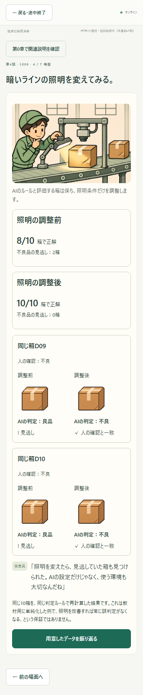

# v0.1.9 — BIAS & FAIRNESS 実装報告

## 1. 実装バージョン

対象：`C:/_wk/github/study-content/01_なぜから学ぶ G検定`。

v0.1.8をベースに、第4話L006「同じ箱なのに、場所が変わるとAIが間違える？」を追加した。新しいラインでの見逃しから、照明調整、データの偏り、人に関わる公平性、用語の整理まで7場面でつながる。事前クイズや数式から始めず、任意演習・深掘りを開かなくても完了できる。

## 2. 新規・変更ファイル

| ファイル                                                                                  | 内容                                                                             |
| ----------------------------------------------------------------------------------------- | -------------------------------------------------------------------------------- |
| `src/data/fairness.ts`（新規）                                                            | 学習用・評価用の30箱、照明係数、場面、用語、深掘り5項目、4問、出典とシラバス対応 |
| `src/engine/fairness.ts`（新規）                                                          | 学習用データからのしきい値、箱ごとの判定、集計、初期進行・完了条件               |
| `src/engine/fairness.test.ts`（新規）                                                     | 計算・データ分離・4問の全選択肢・互換保存・やり直し・統合の10テスト              |
| `src/components/FairnessEpisode.tsx`（新規）                                              | 本編7場面、変化した同じ箱の図、任意演習、深掘りと出典                            |
| `src/types.ts`、`src/engine/learning.ts`                                                  | L006の独立した進行・照明調整・回答・完了と互換バックアップ                       |
| `src/App.tsx`、`src/data/content.ts`                                                      | コース・ホーム・演習・記録・第0章への導線                                        |
| `src/components/GeneralizationEpisode.tsx`                                                | 第3話の結末に「第4話を開く」を追加                                               |
| `src/components/BeginnerGuide.tsx`                                                        | 本文は維持し、関連項目へ直接開く任意パラメータを追加                             |
| `src/style.css`                                                                           | 320px・390px・文字拡大での図と判定ラベル                                         |
| `public/illustrations/l006/`（新規）                                                      | オリジナルのドット絵4点                                                          |
| `tests/fairness.spec.ts`（新規）                                                          | 9シナリオ×2ブラウザ、スクリーンショット                                          |
| `tests/episode.spec.ts`                                                                   | 既存の長いL003ケースを本編完了／任意演習再開へ分割。確認項目は保持               |
| `scripts/performance-reporter.mjs`（新規）                                                | ケース・画面保存の実時間と結果の計測                                             |
| `scripts/check-menu.mjs`                                                                  | L005に加えL006のメニュー版完走と両ビルド照合                                     |
| `package.json`、`package-lock.json`                                                       | v0.1.9へ更新                                                                     |
| `README.md`、`docs/CONTENT_L006.md`、`docs/ASSETS_v0.1.9.md`、`docs/QA_v0.1.9.md`、本報告 | 操作・仕様・素材・検証の記録                                                     |
| `docs/screenshots/v0.1.9/`、各ログ・計測JSON、`app/`                                      | 画面証跡とメニュー版ビルド成果物                                                 |

## 3. 第4話の操作手順

ホーム→「コース」→L006「第4話を始める」→明るい・暗い2ラインの挿絵と検査員の依頼→「2つのラインで試してみる」→全体18/20・明るい10/10・暗い8/10と見逃し2箱→「何が違うのか調べる」→同じルール・種類・目的と、違う照明を確認→「照明を見直してみる」→「暗いラインの照明を調整する」→同じD09・D10が見つかり10/10へ→「用意したデータを振り返る」→偏りの名前と対策→「人に関わるAIの判断も考える」→採用の架空事例と公平性→「第4話をまとめる」→3つの要点とG検定用語→「ここで終える」。

第3話の結末「第4話を開く」からも開始できる。自動では移動しない。「G検定の問題で確認する」「もっと詳しく学ぶ」はまとめ後の任意選択とした。

## 4. 計算方式と実際の結果

学習用T01〜T10は良品6箱（特徴値0.2）と不良4箱（0.8）。良品の最大と不良の最小の中間から、しきい値0.5を計算する。評価用はB01〜B10、D01〜D10に分け、どちらも良品8箱・不良2箱。全30箱のIDは重複しない。

観測特徴値は基準値×照明係数。観測値がしきい値以上なら不良。箱ごとに人の検査結果とAIの判定を比べ、その行データから正解・見逃しを集計する。

| 評価条件               | 係数 | 良品の観測値 | 不良の観測値 | 正解  | 不良の見逃し |
| ---------------------- | ---- | ------------ | ------------ | ----- | ------------ |
| 明るいライン           | 1.0  | 0.2          | 0.8          | 10/10 | 0箱          |
| 暗いライン             | 0.45 | 0.09         | 0.36         | 8/10  | 2箱          |
| 同じ暗いライン・調整後 | 1.0  | 0.2          | 0.8          | 10/10 | 0箱          |

最初の全体は18/20。成績を先に比較できるよう、20箱の個別記録は任意で開く構成とし、見逃した2箱は本編にも表示した。変わるD09・D10は、調整前「人の確認：不良／AIの判定：良品」、調整後「人の確認：不良／AIの判定：不良」。同じ箱のIDと答えを保ち、照明だけを変えて再計算する。固定の結果文字列や判定済みの絵の切替だけで示していない。

数値を使う概念理解用の簡易モデルで、実画像の傷検出やディープラーニングではないことを明記した。暗い場所で必ず誤判定するとも、照明改善で常に満点になるとも教えない。工場の技術的な性能差と、採用・融資・教育での人の機会・権利に関わる公平性の検討を分け、工場実験で社会的公平性を証明したとは述べない。

[全データ・説明・保存仕様](CONTENT_L006.md)。出典のURL・確認日・公式シラバスの対応項目は教材データに保持。JDLA公式Webの「モデルの選択・評価」「データの収集・加工・分析・学習」「公平性」を確認した。Google MLCCの公平性・バイアス・運用監視の解説も確認して独自に要約した。詳細PDFの全内容や、G検定の全範囲を網羅した教材とは表示しない。

## 5. 制作したドット絵

imagegenスキルの組み込みimage_genを使用。既存の`l005/practice-inspection.png`と`ml-inspected-samples.png`を実画像で参照し、新規4点を制作・組み込んだ。

| ファイル                                                                                                  | 使用場面                                               | 寸法      |
| --------------------------------------------------------------------------------------------------------- | ------------------------------------------------------ | --------- |
| [public/illustrations/l006/two-lines.png](../public/illustrations/l006/two-lines.png)                     | 新しい2ライン、照明条件の比較                          | 1536×1024 |
| [public/illustrations/l006/missed-boxes.png](../public/illustrations/l006/missed-boxes.png)               | 暗いラインの出口で見逃しを発見                         | 1536×1024 |
| [public/illustrations/l006/lighting-adjustment.png](../public/illustrations/l006/lighting-adjustment.png) | 照明を調整し箱を見やすくする                           | 1536×1024 |
| [public/illustrations/l006/human-review.png](../public/illustrations/l006/human-review.png)               | 別の面談室で、AIの判断案を人が確かめ、本人の説明も聞く | 1254×1254 |

検査員の帽子・服装・髪と顔、箱とテープ、緑のベルト、内装とドット表現をそろえた。重要な数字・判定は画像へ焼き込まず、プログラムの結果から表示。意味のある代替テキストを付けた。D09・D10の操作前後は既存の透明箱PNGを再利用して、同じ箱であることをIDで示す。

[制作方法・参照画像・最終プロンプト](ASSETS_v0.1.9.md)。既存PNGの上書きは行っていない。新規PNGもローカル配信とオフラインキャッシュに含まれる。

## 6. 挿絵と本文を含む画面

| 場面                    | Chromium 390px                                                   | WebKit 390px                                                          |
| ----------------------- | ---------------------------------------------------------------- | --------------------------------------------------------------------- |
| 新しい2ライン           | [画面](screenshots/v0.1.9/01-new-lines-390-chromium.png)         | [画面](screenshots/v0.1.9/01-new-lines-390-webkit-mobile.png)         |
| 暗いラインでの見逃し    | [画面](screenshots/v0.1.9/02-missed-boxes-390-chromium.png)      | [画面](screenshots/v0.1.9/02-missed-boxes-390-webkit-mobile.png)      |
| 照明調整と同じ2箱の変化 | [画面](screenshots/v0.1.9/04-lighting-adjusted-390-chromium.png) | [画面](screenshots/v0.1.9/04-lighting-adjusted-390-webkit-mobile.png) |
| 人に関わる公平性        | [画面](screenshots/v0.1.9/06-human-fairness-390-chromium.png)    | [画面](screenshots/v0.1.9/06-human-fairness-390-webkit-mobile.png)    |
| まとめ                  | [画面](screenshots/v0.1.9/07-ending-390-chromium.png)            | [画面](screenshots/v0.1.9/07-ending-390-webkit-mobile.png)            |

[条件の違いと原因](screenshots/v0.1.9/menu-l006-cause-390-chromium.png)／[原因説明の320px・文字拡大](screenshots/v0.1.9/menu-l006-cause-320-chromium.png)／[320px通常](screenshots/v0.1.9/lighting-320-chromium.png)／[320px文字拡大](screenshots/v0.1.9/lighting-320-large-chromium.png)／[WebKit文字拡大](screenshots/v0.1.9/lighting-320-large-webkit-mobile.png)／[任意の詳細](screenshots/v0.1.9/optional-details-390-chromium.png)／[オフラインの公平性画面](screenshots/v0.1.9/fairness-offline-390-webkit-mobile.png)／[メニュー版](screenshots/v0.1.9/menu-l006-lighting-390-chromium.png)。

全7場面について、320px幅と28px相当の文字拡大で横スクロール、切れ、主要ブロックの重なり、人物・箱・操作ボタンの表示を検査した。

## 7. 問題演習の確認

4問×4選択肢の16通りについて採点と解説を単体テストで確認。ブラウザでは4問すべての正解と16選択肢の解説を表示し、Q1の誤答→解き直し→正答も確認した。履歴5件が再読込・やり直し後も残り、L003の回答・L004の回答は変化しない。

演習を開かずに本編を完了し、完了記録が残ることも確認した。「もっと詳しく学ぶ」はA〜Eの全項目について、やさしい説明・具体例・詳細説明の順、閉じる操作を確認した。計算方法は任意の折りたたみで読める。

## 8. 旧データの互換性

formatVersionは1のまま。L006なしの旧バックアップも検証・読込できる。L006の再開は現在の場面・照明調整・演習位置を復元し、やり直しはL006の今回の状態だけを初期化。過去の完了と回答は保持する。

テストではv0.1.1のL003保存を含む、L004の回答・L005の途中位置・予想・3話分の過去完了を持つv0.1.8形のデータを使用した。L006の操作・やり直し・完了・JSON書出し／復元で、既存の進行・回答・復習候補・設定が保持された。旧バックアップの統合でL006が消えないこと、話ごとに更新時刻で選ぶこと、同じ履歴IDの内容矛盾を拒否することも単体テストで確認した。

第4話から第0章の関連する項目を開閉しても、元の場面・照明調整状態・保存内容を維持する。既存の第0章の概要・深掘り、第1〜3話の本文・計算・画像・問題は保持している。

## 9. 単体・ブラウザテスト

| 確認                    | 結果                                                      |
| ----------------------- | --------------------------------------------------------- |
| 単体テスト              | 62件成功、7ファイル（既存52件＋追加10件）                 |
| L006追加ブラウザテスト  | 18件成功、9シナリオ×Chromium/WebKit                       |
| 時間切れ対策の反復      | 12件成功、2ケース×2ブラウザ×3回、再試行なし               |
| 全体ブラウザ回帰        | 110件成功、再試行なし。画面整理後のL006も追加18件を再確認 |
| LF・UTF-8・差分チェック | UTF-8（BOMなし）・LF、差分チェック成功                    |

[単体ログ](test-v0.1.9.txt)／[追加E2E](e2e-addition-v0.1.9.txt)／[反復ログ](e2e-repeat-v0.1.9.txt)／[全体ログ](e2e-v0.1.9.txt)。

前回のケースは本編完了と任意演習再開に分割し、元の確認項目を保持。設定どおり1 workerで実行し、45秒のタイムアウトを増やしていない。WebKitの反復では本編5.471〜5.969秒、演習再開3.527〜4.033秒で成功した。ケース・画面保存の実時間を記録し、単なるタイムアウト延長や失敗の隠蔽としていない。

[調査・計測・限界の詳細](QA_v0.1.9.md)／[全体の計測JSON](performance-v0.1.9.json)。

## 10. 通常版・メニュー版ビルド

- `npm run build`：成功。distへ出力。
- `npm run build:menu`：成功。appへ出力。
- Service Worker：22資産をキャッシュ。新規4PNG・本文・解説を含む。
- `node scripts/check-menu.mjs`：dist/appの全23ファイルがバイト一致。メニュー版のL005とL006を390pxで完走し、実際に画像が読めることを確認。

[通常版ログ](build-v0.1.9.txt)／[メニュー版ログ](build-menu-v0.1.9.txt)／[配信・完走確認](menu-smoke-v0.1.9.txt)。

## 11. iPhone実機の確認範囲

**iPhone実機は未確認。** ChromiumとWebKitのモバイル設定での確認を、実機試験とは扱っていない。実機のSafari・文字拡大・ホーム画面追加・端末固有の表示や保存挙動は別途確認が必要。

## 12. 残課題

- iPhone実機での確認。
- 前回の並列実行時の遅延自体は再現できておらず、OSのCPU・I/Oのどちらによる遅れかまでは未特定。今回のケース分割と単一workerの条件で、反復・全体回帰の計測結果を残した。
- 工場の結果は教材用の単純化したモデルの範囲。実画像認識の性能や、採用AIなどの社会的公平性を保証する実験ではない。

こちらではcommit・push・公開を行っていない。改行はLF。
