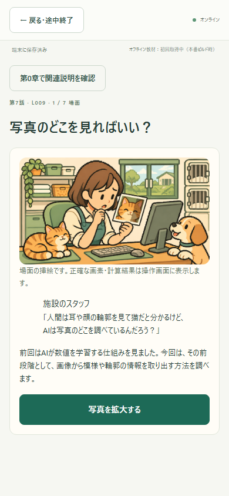
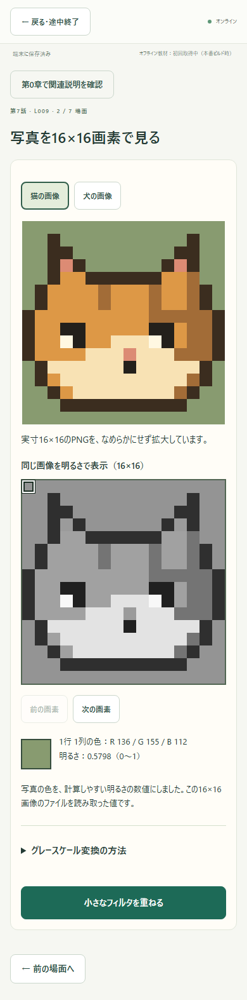
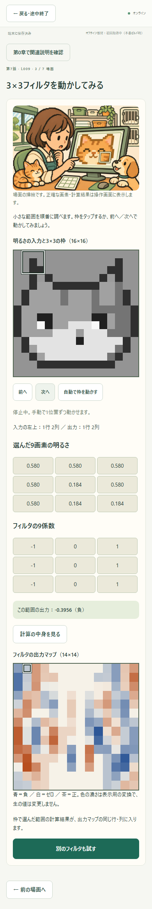
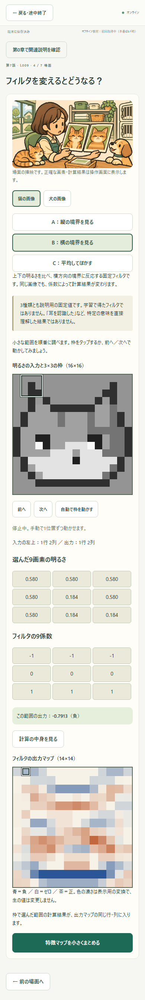
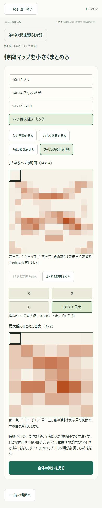
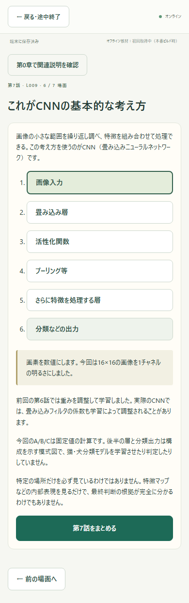
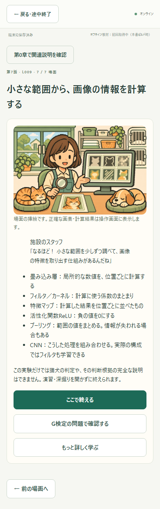

# v0.2.2 — 第7話 L009 実装報告

対象：`C:/_wk/github/study-content/01_なぜから学ぶ G検定`。確認日：2026年11月22日。

## 1. 実装バージョン

v0.2.2「CNN IMAGE LAB」。L003〜L008との重複を確認してL009を採用した。動物保護施設で、実PNGの画素から小さなフィルタの計算を動かす7場面を追加した。

## 2. 新規・変更ファイル

| 区分                                                     | ファイル                                                                              |
| -------------------------------------------------------- | ------------------------------------------------------------------------------------- |
| 本編・画像読み取り・操作図                               | `src/components/CnnEpisode.tsx`（新規）                                               |
| 7場面・5深掘り・5問・4出典                               | `src/data/cnn.ts`（新規）                                                             |
| グレースケール・相互相関・ReLU・最大値プーリング・色変換 | `src/engine/cnn.ts`（新規）                                                           |
| 単体／ブラウザテスト                                     | `src/engine/cnn.test.ts`、`tests/cnn.spec.ts`（新規）                                 |
| 新規画像・制作処理                                       | `public/illustrations/l009/` の6点、`scripts/create-l009-sprites.mjs`                 |
| 入口・履歴・保存互換性                                   | `src/App.tsx`、`BeginnerGuide.tsx`、`TrainingEpisode.tsx`、`types.ts`、`learning.ts`  |
| 表示・版・配信                                           | `style.css`、`package*.json`、`README.md`、`vite.config.ts`、`check-menu.mjs`、`app/` |
| 証跡                                                     | `docs/` の本報告、ASSETS、QA、指示、計算JSON、ログ、`screenshots/v0.2.2/`             |

前回v0.2.1の未コミット変更を維持した。第0〜6話の画像・教材データは変更せず、第6話には結末の入口だけを追加した。

## 3. 第7話の全操作手順

ホーム「3分で全体像を見る」→第0章「第7話で、画像とフィルタを動かす」→「写真を拡大する」→「小さなフィルタを重ねる」→画像／出力をタップ、または「前へ」「次へ」→「別のフィルタも試す」→任意でA/B/C・猫／犬を切替→「特徴マップを小さくまとめる」→フィルタ結果→ReLU結果→プーリング結果→「全体の流れを見る」→「第7話をまとめる」→「ここで終える」。コース一覧と第6話の結末からも開始できる。数式・演習・深掘りを開かず完了できる。

## 4. 各場面で学べる内容

| 場面                        | 操作と発見                                                    |
| --------------------------- | ------------------------------------------------------------- |
| 01 写真のどこを見ればいい？ | 暗めの写真を見て、第6話の数値学習から画像の局所情報へつなぐ   |
| 02 16×16画素                | 実PNGを拡大し、画素のRGBと0〜1の明るさを見る                  |
| 03 3×3フィルタ              | 9画素・9係数・合計・出力位置を同期して動かす                  |
| 04 別のフィルタ             | 係数によってマップが変わり、負・ゼロ・正があると知る          |
| 05 小さくまとめる           | 16→14→14→7でReLUと最大値プーリングを別々に体験する            |
| 06 CNNの基本                | 6段階を押して説明を見る。前半の実計算と後半の模式図を区別する |
| 07 まとめ                   | 6用語を整理し、演習なしで終了する                             |

## 5. 新規ドット絵と保存先

[画像一覧](ASSETS_v0.2.2.md)に6点のパス・寸法・用途を記載した。物語用4点を画像制作機能で制作し、猫・犬の計算入力2点を16×16 PNGとして描いた。第5・6話と同じスタッフ、服装、動物、室内を参照した。既存素材は上書きしていない。

## 6. 組み込み後のスクリーンショット

挿絵単体ではなく本文・操作部品と一緒の390px画面を保存した。









犬画像の9項、深掘り、演習、320px文字拡大も `screenshots/v0.2.2/` に保存した。

## 7. 16×16画素の入力画像

`cat-16.png` と `dog-16.png` は実寸16×16 RGBA PNG。アプリはImageをCanvasへ等倍描画し、256画素を取得する。作画スクリプトの配列は実行時に使わない。表示だけ `image-rendering: pixelated` で拡大する。

透明度a=A/255として各RGBを `v×a＋255×(1−a)` で白と合成し、明るさを `(0.2126R＋0.7152G＋0.0722B)/255` で求める。sRGB値による近似と明記した。元値は丸めず、表示だけ丸める。

## 8. 3×3フィルタの係数

```
A: -1  0  1    B: -1 -1 -1    C: 1/9 1/9 1/9
   -1  0  1        0  0  0       1/9 1/9 1/9
   -1  0  1        1  1  1       1/9 1/9 1/9
```

Aは左右を比べて縦の境界に、Bは上下を比べて横の境界に反応する。Cは9画素の平均。すべて説明用の固定値で、学習済み係数ではない。

## 9. 特徴マップの実計算方式

1チャネル、ストライド1、パディングなし、反転なし。9画素と9係数の積を足し、14×14の196位置すべてを計算する。数学的には相互相関であり、畳み込みとの違いをD01で説明した。猫／犬、A/B/Cの全結果は [計算JSON](calculation-v0.2.2.json) に保存した。右列だけ1の3×3にAを掛けて3になる手計算例も独立テスト済み。

青＝負、白＝ゼロ、茶＝正の表示変換は元配列を変更しない。符号と値は文字でも示す。固定画像への差替えではなく、計算結果をCanvasへ描く。

## 10. ReLU・プーリングの計算方式

14×14に `max(0,x)` を適用し、負だけを0へ変える。その結果を2×2・ストライド2で区切り、4値の最大を7×7へ出力する。選択中の2×2、4値、最大、出力位置を表示する。同点はすべて「最大」と表示。情報が失われ得ること、すべてのCNNで必須ではないことも説明した。

## 11. 画面操作と計算結果の同期

入力タップ、出力タップ、前後ボタン、矢印キーは同じ位置を更新し、3×3枠・9項・合計・出力の1マスを同期する。画像・フィルタ変更時は全マップを再計算し、読込中に古い画像の数値を表示しない。ブラウザでPNGを独立にデコードし、9項・合計・全196マスの色・プーリング最大値を照合した。

自動送りは停止可能で、第0章表示中・ページ非表示時に停止し、再開後に自動開始しない。「動きを減らす」設定では無効にする。

## 12. 深掘り5項目

D01 畳み込みと相互相関、D02 ストライドとパディング、D03 特徴マップとチャネル、D04 ReLUとプーリング、D05 フィルタの学習。各項目に「やさしい説明→具体例と今回の図→技術説明→用語・出典」を用意した。現在の入力、位置、A/Bの実マップ、ReLU、2×2最大値、固定係数を引用する。開閉状態を保存し、閉じると元の項目へ戻る。閲覧は完了条件外。

## 13. 任意演習5問

CNN、畳み込み層、フィルタと特徴マップ、ReLU・プーリング、係数の学習の4択5問。正解は配列インデックス1・0・2・3・1。20選択肢すべてに個別解説を持つ。誤答→解き直し、問題番号、再開後の解説も保存する。公式問題ではないと明示した。

## 14. 保存・再開・旧データ互換性

既存 `formatVersion:1` を維持して任意フィールド `cnn` / `cnnAttempts` を追加した。画像、フィルタ、枠・画素・プール位置、処理段階、説明項目、式の開閉、深掘り、問題番号、回答を保存し、マップは復元状態から再計算する。

「最初から学ぶ」は第7話の現プレイだけを初期化し、回答・完了記録・第0〜6話を保持する。第0章往復、旧版履歴、JSONエクスポート／置換復元／統合を検証した。再開時は閲覧日時だけ更新する。

## 15. 単体テスト・E2E結果

最終値は [QA_v0.2.2.md](QA_v0.2.2.md) とログに記載する。単体は実PNG、透明画素、手計算、全196位置、符号、ReLU、49最大値、保存・統合、5問20選択肢を検証。E2Eは390px全編、320pxと文字拡大、演習、深掘り、オフライン、再開・リセット・復元、既存全話をChromium／WebKitで検証する。

## 16. 通常版・メニュー版ビルド

`npm run build` と `npm run build:menu` を実行し、Service Workerが分割JSと新規PNGを含むことを確認する。`dist` と `app` の全ファイルをバイト比較し、メニューURLでL005〜L009を完走する。結果はQAに記載する。

## 17. iPhone実機

**iPhone実機は未確認。** ChromiumとPlaywright WebKitモバイル環境で確認した。実機Safari固有動作、実機の文字拡大・低速回線・省メモリ条件は未確認。

## 18. 既知の問題・残課題

固定フィルタは猫犬認識モデルではなく、後半の分類出力は構成を伝える模式図。特徴マップだけで最終判断を完全に説明できるとは表示していない。物語挿絵は状況表現で、正確な計算図はアプリが描画する。オフライン利用には初回オンライン取得の完了が必要で、出典リンク先はオンライン専用。iPhone実機確認は未実施。

改行はLF。commit・push・公開は行っていない。

出典：[JDLA](https://www.jdla.org/certificate/general/)、[TensorFlow CNN](https://www.tensorflow.org/tutorials/images/cnn)、[Conv2D](https://www.tensorflow.org/api_docs/python/tf/keras/layers/Conv2D)、[tf.nn.conv2d](https://www.tensorflow.org/api_docs/python/tf/nn/conv2d)。教材データにURL、対象範囲、確認日を保持した。
